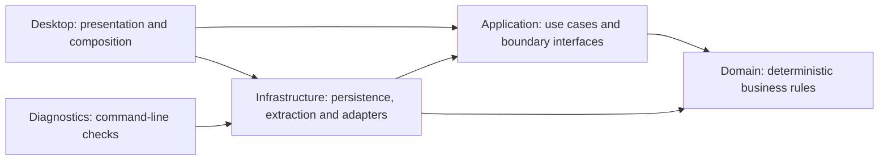

# Architecture

QuoteMatch is a single-process desktop application. Local document review, comparison and purchase preparation work independently from the optional external-system integration.

## Projects and dependency direction

| Project | Responsibility | Entry points |
| --- | --- | --- |
| `QuoteMatch.Domain` | Identity, grouping, conversion, comparisons, purchase eligibility and operation validation | [Analysis](../src/QuoteMatch.Domain/Analysis/ImportedQuotationAnalysis.cs), [purchasing](../src/QuoteMatch.Domain/Purchasing/PurchasePreparation.cs) |
| `QuoteMatch.Application` | Import/review coordination and interfaces for external effects | [Import service](../src/QuoteMatch.Application/Importing/PdfImportService.cs), [product review](../src/QuoteMatch.Application/Analysis/ProductReviewService.cs), [synchronization](../src/QuoteMatch.Application/Purchasing/SynchronizationWriteService.cs) |
| `QuoteMatch.Infrastructure` | SQLite/EF Core, PDF and spreadsheet readers, SQL Server adapters and protected credentials | [Local store](../src/QuoteMatch.Infrastructure/Persistence/SqliteImportStore.cs), [ERP adapter](../src/QuoteMatch.Infrastructure/Erp/ErpGateway.cs) |
| `QuoteMatch.Desktop` | Avalonia views, MVVM screen state, localization, preferences and dependency wiring | [Startup](../src/QuoteMatch.Desktop/App.axaml.cs), [workspace composition](../src/QuoteMatch.Desktop/ViewModels/WorkspaceViewModel.cs) |
| `QuoteMatch.Diagnostics` | Sanitized checks against an explicitly configured local profile | [Commands](../src/QuoteMatch.Diagnostics/Program.cs) |

Domain has no UI, ORM, PDF-library or SQL-client dependency. Infrastructure implements real boundaries defined by Application. Desktop composes concrete implementations; there is no runtime plugin discovery, background service or dependency on another desktop application.

Optional application updates use `IApplicationUpdater` in Application, a Velopack adapter in Infrastructure and update state/presentation in Desktop. The startup hook runs before Avalonia; downloading does not apply an update. An explicit guarded restart hands application replacement to the packaged updater. See [releases and updates](releases-and-updates.md).

## Data ownership

The workflow keeps distinct records for:

1. Original source bytes, hash and template snapshot.
2. Captured fields, source page/row and extraction evidence.
3. Reviewed values and explicit exclusions.
4. Product links, confirmed conversions and reusable supplier mappings.
5. Desired quantities and their document/order provenance.
6. Versioned analysis inputs and saved purchase choices.
7. External-operation plans, reservations and receipts.

Corrections do not overwrite original evidence. Template changes and refreshed external data do not rewrite historical snapshots. Product mappings identify exact source references; grouping and text searches do not authorize substitutions. [Business rules](business-rules.md) specify those distinctions.

## Local persistence

`SqliteImportStore` is a concrete repository implemented across focused partial files. Each operation creates a short-lived `ImportDbContext`; read-only paths use tracking-free queries where appropriate. Fluent API mappings apply to persistence rows, keeping database details out of domain records.

Original documents are stored as SQLite blobs with their proposal metadata. Snapshot JSON and invariant decimal text preserve exact values without relying on SQLite floating-point arithmetic. Local version checks and transactions reject stale writes and keep multi-item review changes atomic. Migrations create a consistent SQLite backup before upgrading an existing store.

The data-directory override, preferences and native credential protection are configured at startup. There is no checked-in application database or production configuration.

## Document processing

PDF processing separates text extraction, layout strategy, page-scoped segmentation, field capture, numeric conversion and validation. Automatic recognition uses an identifier and a short item probe, then reuses text for full extraction. Spreadsheet processing preserves source rows, displayed codes, explicit culture and original file bytes.

Both paths feed the same reviewed-offer model. Regex and input budgets, cancellation, explicit numeric cultures and visible incomplete captures limit the effects of malformed or incompatible documents. A review must be confirmed before it becomes a saved proposal.

## External integration

The current adapter uses parameterized SQL Server queries and typed result contracts. A remote schema maps into QuoteMatch's contracts; its table names and status codes do not belong in Domain. Existing result aliases are retained for compatibility and are documented in [ERP integration](erp-integration.md).

The boundary interfaces support replacing infrastructure implementations, but this is a source-code extension point. A different database engine or HTTP API is not enabled merely by changing SQL in Settings. Its transport, credentials, limits and composition require an adapter.

Some purchasing assumptions are part of the current application model: whole lots, catalog-scoped identity, explicit brand grouping and history-backed buying suppliers. A system with different semantics needs a deliberate contract/rule change and migration review. The presence of an interface alone does not prove interoperability.

## Transactions and uncertain outcomes

SQLite and an external ERP are separate transaction domains. A confirmed plan is journaled locally before dispatch. Creation saves the external number/control reservation before inserting the order. The adapter validates current target data and approved financial values within its transaction.

If acknowledgment is lost, the operation remains pending or uncertain. Reconciliation checks the original operation identity and its result; it does not replay the write. This design does not claim a distributed transaction or universal exactly-once execution. See [order contracts](purchase-order-scripts.md) for the installation's responsibilities.

## Presentation and verification

Views handle layout, focus, dialogs, file pickers and file-drop presentation. ViewModels coordinate screen state and call use cases/repositories; they do not access `DbContext`. User-facing text uses localization resources and semantic theme resources.

[Tests](testing.md) combine deterministic domain checks, actual SQLite integration and headless desktop interactions. Test fixtures are synthetic, including ERP boundary responses. Native desktop behavior and live installation scripts require additional verification in the intended environment.
